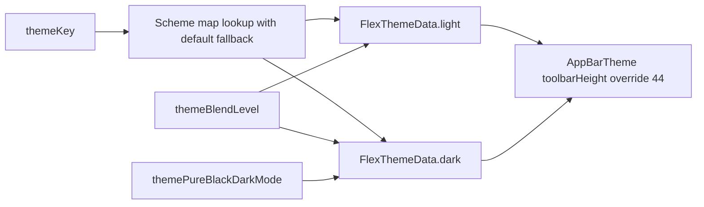

# Tachimanga 5.1 — السمة والألوان والخطوط

21 أكتوبر 2026. متابعة ثابتة للعينة المعدلة 5.1/520 نفسها. لم يُشغّل كودها،
ولا تُثبت هذه النتائج المظهر النهائي لكل شاشة أو كل خط عربي على الجهاز.

الأداة: [review_tachimanga_appearance.py](../scripts/review_tachimanga_appearance.py).
الأدلة: [appearance.json](../validation/rea/tachimanga-5.1-appearance.json).
قورنت **17 طريقة، 1,492 تعليمة و5,968 بايت** ببايتات App بواسطة Capstone،
مع **29 موضع تحقق** للنداءات والفروع وoperands الأساسية. يشمل ذلك تفضيلات
المظهر، وبناء السمة، وربط primary ومكونات Color، وفرع Typography الخاص بـiOS.

```bash
python3 scripts/review_tachimanga_appearance.py /path/to/tachimanga-analysis-5.1 /tmp/appearance.json
```

تحتاج إعادة الفحص ملفات التصدير الأصلية واستعلام pool الخارجي
`flutter-full/appearance-followup/appearance-pool.json` وFontManifest.json
المطابق لبصمته في جرد IPA. الأداة الثنائية المراجعة وإزاحات الاستعلام موثقة
في JSON؛ لم تُنقل الأداة أو الخطوط أو كود العينة إلى التطبيق.

## مفاتيح المظهر وافتراضياتها

| المفتاح | الافتراضي | دليل build |
|---|---|---|
| `themeMode` | system؛ الخيارات system/light/dark | `0x3c5a34` |
| `themeKey` | `default` | `0x395a9c` |
| `themeBlendLevel` | 10.0 | `0x3a4204` |
| `themePureBlackDarkMode` | false | `0x393d80` |

هذه قيم التهيئة عند غياب الإعداد المحفوظ. يقرأ ThemeSchemeColor.build عند
`0x3ae004` providers للمفتاح والمزج والأسود الصافي. إذا لم يجد المفتاح في
الخريطة يستعمل FlexSchemeData الافتراضي؛ ليس كل اسم سمة جديد ضمانًا لوجوده.

مسار بناء الألوان:



يرتبط light بمجموعة scheme في logical offset `0x18`، وdark بالمجموعة عند
`0x20`. هذه علاقة ثبتت من operands عند `0x3ae160` و`0x3ae1c4` ووجهتي النداء.

## اللون الأساسي ليس مطابقًا للقيم الحالية في MSL

ثُبت أن primary في FlexSchemeColor هو الحقل المنطقي `0x8` عبر copyWith
عند `0x3c1648`، ثم ثُبتت offsets قنوات Color بواسطة getters مستقلة:
alpha=`0x8` وred=`0x10` وgreen=`0x18` وblue=`0x20`.
حُولت مكونات sRGB في كائنات مخطط `default` إلى RGB بثمانية بتات:

| القيمة | مخطط العينة default | ShelfStyle الحالي في MSL |
|---|---|---|
| primary الفاتح مقابل accent الفاتح | `#335CA8` | `#345DA8` |
| primary الداكن مقابل accent الداكن | `#AEC6FF` | `#A8C2FF` |

هذه مقارنة بين **primary المخطط** و**accent المشروع**، وليست إثباتًا أن كل
زر أو تبويب مرجعي يستعمل primary دون أي تحويل. بيانات القنوات مأخوذة من
فهرس الكائنات المراجع؛ لا تُقدّم كل قناة هنا باعتبارها فك ترميز رقميًا مستقلًا
من snapshot. تحقق ترميز الأرقام المستقل في هذه المتابعة يخص 10 و44 فقط.

يبني FlexColorScheme أسطح الألوان والمكونات من هذه البيانات ومستوى المزج.
لذلك لا يكفي تغيير accent وحده أو افتراض أن كل شاشة لها خلفية ثابتة واحدة.
القيم القديمة في [دليل MSL](INTERFACE-STYLE-AR.md) تبقى مواصفة تنفيذ سابقة،
ولا يُعاد تصنيفها على أنها قياسات جديدة من العينة.

## الأسود الصافي والترويسة

عندما يكون الأسود الصافي true، يضع الفرع الداكن blend level=0 ويختار لون
scaffold صريحًا أسود `#000000`. عند false يمرر المزج المعتاد وتفضيل
FlexScaffoldBaseColor باسم `surfaceContainer`. لا يغير هذا الفرع نفسه مزج light.
يحتاج MSL إلى فصل هذا الخيار عن مجرد dark mode، مع حفظه وتطبيقه على الأسطح
الصحيحة؛ وجود خلفية داكنة `#18181A` وحدها لا يغطي هذه السياسة.

بعد بناء light وdark، يطبق ThemeSchemeColor override لـAppBarTheme
`toolbarHeight=44.0` عبر copyWith. حُسم اسم المعامل من descriptor المصفوفة،
وفُك الرقم 44 من بايتات App مستقلًا؛ كذلك فُك 10 الافتراضي للمزج.
هذا ارتفاع toolbar في السمة، **ليس قياسًا لارتفاع الترويسة المرئية كاملة**؛
Safe Area وwidget overrides وفروع مضيف iOS 26 قد تغير المساحة النهائية.

## الخطوط: ما ثبت وما بقي

FontManifest.json المطابق لجرد IPA يحوي ثلاث عائلات:

- MaterialIcons.
- icomoon.
- packages/cupertino_icons/CupertinoIcons.

هذه عائلات رموز؛ manifest لا يضم خطًا نصيًا خاصًا يمكن نسبته إلى واجهة
التطبيق. لم تُنسخ ملفات خطوط إلى MSL بهذه المتابعة.

في framework المشحون، Typography._withPlatform عند `0x20bce4` يقارن
TargetPlatform.iOS، ثم يختار زوج TextTheme عند pool `0xc668` و`0xc670`.
يحوي الزوج **CupertinoSystemDisplay** و**CupertinoSystemText**؛ بينما
الفروع الأخرى تحوي أيضًا Roboto. إذًا العثور على كلمة Roboto في العينة
لا يثبت أن واجهة iPhone تستخدمه.

هذا يثبت **فرع fallback في framework**. لا يغلق وحده أي override لاحق
لـfontFamily أو TextStyle داخل التطبيق، ولا أسماء glyph fallback العربية،
ولا الوزن والحجم وارتفاع السطر لكل صف. لم يُثبت اختيار كل TextStyle في كل
widget أو المسار النهائي لكل رسم Native. تبقى هذه ضمن UI-07 ومقارنة الجهاز.

## أثر الدراسة على التنفيذ والتحقق

- SET-04: خيارات themeKey والمزج والأسود الصافي مستقلة عن themeMode وعن
  خلفية القارئ وإعدادات العنوان.
- UI-06: مقارنة primary والألوان الناتجة والأسطح المطبقة في كل حالة قبل
  تعديل palette؛ تسجيل السمة والمزج والأسود الصافي مع كل لقطة.
- UI-07: فصل خط الرموز عن خط النص، وتتبع TextStyle على مستوى المكوّن،
  ثم مطابقة EN/AR وDynamic Type والوزن والمسافات على الجهاز.
- UI-08: قياس الترويسة داخل سياقها الفعلي؛ لا تُستبدل كل ارتفاعات MSL بـ44
  اعتمادًا على theme override وحده.

هذه متابعة تحليل وتحديد فجوات؛ لم يتغير كود مظهر التطبيق أو IPA المثبتة.
