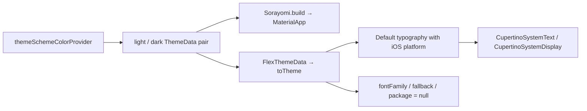

# Tachimanga 5.1 — ربط السمة العامة وخط النص

21 أكتوبر 2026. متابعة ثابتة للعينة المعدلة 5.1/520. تربط هذه الدراسة
[نتائج المظهر](TACHIMANGA-5.1-APPEARANCE-AR.md) بموضع إنشاء التطبيق، مع إبقاء
تنسيق النص لكل شاشة ورسم العربية والخطوط الأصلية في مضيف iOS مسائل مستقلة.

الأداة: [review_tachimanga_font_route.py](../scripts/review_tachimanga_font_route.py).
الأدلة: [font-route.json](../validation/rea/tachimanga-5.1-font-route.json).
فُحصت **12 طريقة، 5,977 تعليمة و23,908 بايت** مقابل بايتات App، مع
**29 موضع تحقق** للنداءات والفروع وoperands. لم يُشغّل كود العينة.

## من provider إلى MaterialApp

Sorayomi.build عند `0x595aa0` يقرأ provider من جدول static عند `0x33f8`،
ويهيئه عبر حقل pool `0xb830` ثم يراقبه عند `0x595c2c`.
حُسم اسم الحقل من snapshot: **themeSchemeColorProvider**، ورقم slot=1663؛
1663×8 يطابق `0x33f8` في التعليمات.

بعد ذلك يأخذ light وdark من الحقلين `0x7` و`0xf` للزوج الناتج، ويضعهما
في حقلي MaterialApp `0x5f` و`0x67` عند `0x595fbc` و`0x595fc4`.
تقرأ _MaterialAppState._themeBuilder الحقلين نفسيهما عند اختيار السمة
الداكنة أو الرجوع إلى الفاتحة؛ بذلك ثبت الربط من الحالة إلى واجهة التطبيق.



## كيف حُسمت معاملات الخط؟

descriptor استدعاء ThemeData عند pool `0x39af0` مصفوفة من **159 عنصرًا**؛
يصف 78 معاملًا إجماليًا و77 معاملًا مسمى. المساعد السابق كان يقف عند
128 عنصرًا، لذلك احتاجت هذه المتابعة استعلامًا منفصلًا بحد 512 عنصرًا، مع
إبقاء الأداة السابقة وبصمتها ونتائجها دون تعديل.

استدعاء ThemeData.factory عند `0x3afa3c` ينشأ داخل FlexColorScheme.toTheme.
بعد ربط موضع كل اسم في descriptor بموضعه على مكدس معاملات Dart:

| المعامل | موضعه في descriptor | الإزاحة من مكدس المعاملات | آخر كتابة قبل النداء |
|---|---:|---|---|
| fontFamily | 28 | `0x188` | null عند `0x3af898` |
| fontFamilyFallback | 29 | `0x180` | null عند `0x3af89c` |
| package | 30 | `0x178` | null عند `0x3af89c` |
| platform | 6 | `0x238` | ثابت TargetPlatform.iOS في هذا البناء |

الإزاحة هنا `(78 − position − 1) × 8`. **مكدس Dart في هذه التعليمات هو
السجل x15** الذي يسميه تصدير dae بـSP؛ لا يُخلط مع سجل sp المعماري للنظام.
وnull هو سجل Dart المحجوز x22.

قُرئت تعليمات إعداد المعاملات الأخيرة مباشرة بواسطة Capstone؛ تحقق الفاحص
من عدم وجود انتقال تحكم أو تحريك مكدس أو كتابة لاحقة تغير معاملات الخط
الثلاثة قبل النداء. ThemeData.factory يخزن fontFamily ثم يتجاوز تطبيق
استبدال العائلة عند null في الفرع `0x209bbc`.

## قاعدة النص العامة

toTheme يضع TargetPlatform.iOS في سياق defaultTypography، وحُسم callback
عند pool `0x39aa8` إلى الوظيفة `0x3bfc10`. يختار هذا المسار Typography
Material 2021 أو Material 2018 بحسب تهيئة Material، ثم يمر عبر اختيار
Typography الخاص بـiOS. زوج TextTheme هناك يحوي CupertinoSystemText
وCupertinoSystemDisplay كما ثبت في تقرير المظهر.

يتبع ذلك دمجان لـTextTheme بمعامل null؛ يتحقق TextTheme.merge من null
ويعيد المستقبل دون تغيير في هذا الفرع. كما أن متابعة المظهر السابقة أثبتت
أن المعالجة اللاحقة لـThemeData تخص appBarTheme وtoolbarHeight.

إذًا **قاعدة السمة العامة في المسار المفحوص تعتمد Typography الخاص بـiOS،
ولا تفرض fontFamily أو حزمة خط مخصصة في استدعاء ThemeData هذا**.
تبقى أي TextStyle محلية، وخطوط glyph fallback العربية، والأوزان والأحجام
وارتفاع السطر وDynamic Type، وأي مكونات Native، ضمن التحقق المطلوب.
لا تُستنتج المطابقة البصرية من استعمال SwiftUI للخط النظامي وحده.

## مفاتيح السمات

كشف الاستعلام أيضًا بيانات خريطة lookup التي يستعملها ThemeSchemeColor:
**124 عنصر بيانات = 62 زوج مفتاح/قيمة**. القائمة الكاملة محفوظة في JSON.
من مفاتيحها default وgreenapple وlavender وmidnightdusk وstrawberry وtako
وtealturqoise وtidalwave وyinyang وyotsuba، ثم مفاتيح إضافية منها blue وindigo
وmaterialBaseline وعائلة M3.

تحفظ تهجئة المفاتيح كما في البيانات، بما فيها tealturqoise. هذه مفاتيح
lookup المثبتة؛ عددها لا يثبت أن قائمة الاختيار تعرضها كلها أو أن بوابات
المنتج في العينة المعدلة تطابق التوزيع الرسمي. أسماء العرض والترجمة والحفظ
مرتبطة بـSET-01/04 قبل بناء واجهة الاختيار.

## الأدوات والمنشأ وإعادة الفحص

أضيف [tachimanga_object_details.rs](../scripts/tachimanga_object_details.rs)
إلى checkout dae الخارجي المثبت نفسه. يعرض metadata للمصفوفات وحقول الكائنات
والمراجع، بحد عمق 3 و512 عنصرًا و32 حقلًا، ولا يستدعي أو يربط كود العينة.
بُني target مستقل باسم object_details بوضع release وCargo.lock مثبت، دون
تغيير pool_audit السابق. بصمات المصدر والمساعد والأداة والسجل والاستعلام
محفوظة في دليل font-route.json.

لبنائه من المصدر المثبت والمجهز بالوصفة السابقة، يضاف الملف المؤلف إلى
`src/bin/object_details.rs` ثم ينفذ داخل checkout الأداة:

```bash
cargo build --release --locked --no-default-features --bin object_details
```

صيغة الاستعلام: `object_details APP SDK_PROFILE PLATFORM_PROFILE PP_OFFSET...`؛
الإزاحات في دليل JSON، وstdout في `flutter-full/font-route-followup/objects.json`.
استعلام callback الصغير يستعمل pool_audit السابق ويحفظ callbacks.json بجانبه.
استُخدمت CPU واحدة وحد 3 GiB و60 ثانية CPU و90 ثانية كلية، وفُحص SHA-256
لـApp قبل الاستعلامين. إعادة فحص الأدلة:

```bash
python3 scripts/review_tachimanga_font_route.py /path/to/tachimanga-analysis-5.1 /tmp/font-route.json
```

أثناء مقارنة التعليمات وُجد موضعان يعرضهما dae كـORR مع xzr، ويعرضهما
Capstone كـMOV immediate. لا يتجاوز الفاحص الاختلاف بالاسم فقط: يشترط
تطابق سجل الوجهة والقيمة ذات 64 بت، ويسجل الموضعين في JSON.

لم يتغير كود واجهة MSL أو IPA في هذه المتابعة. تبقى UI-07 وUI-08 مفتوحة
حتى مراجعة المكونات الفعلية والصور المرجعية والجهاز.
