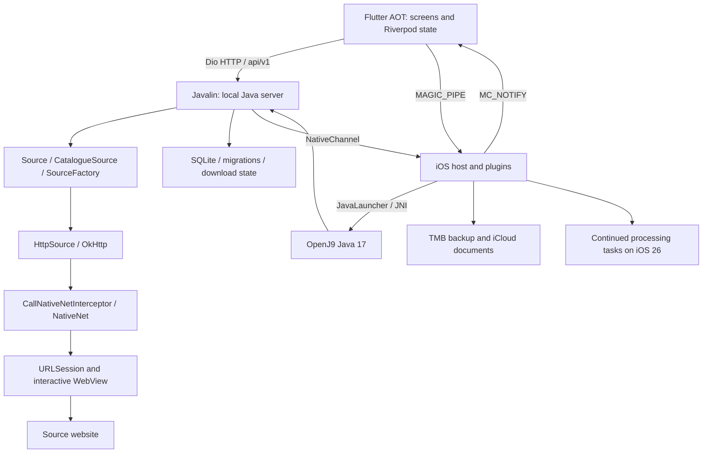

# تحقيق Tachimanga 5.1: البناء والعقود وفجوات MangaShelf

## النتيجة الأساسية

Tachimanga في العينة المقدمة تطبيق **Flutter + مضيف iOS أصلي + خادم Java/Kotlin
مضمن على OpenJ9 Java 17**. واجهة Browse ترسل HTTP إلى Javalin المحلي؛ الخادم
يحمّل مصادر Tachiyomi الفعلية، ويعبر نقلها من OkHttp إلى JNI ثم URLSession.
هذه منظومة أكبر من واجهة وقارئ ملفات أو فهرس إضافات.

الأسهم تصف مسارات مثبتة من الملفات، وليست تسجيلًا لتشغيل ناجح. استنتاج اختلاف
هذه البنية عن موزع JSON-string التجريبي في MSL مدعوم بتواقيع Source وSourceFactory
وتعليمات Java ومسارات HTTP وقنوات iOS؛ لذلك لا يصلح تعديل الواجهة وحده الإضافات.

## العينة وحدود الهوية

- الملف الذي قدمه المستخدم: `12696-Tachimanga v5.1 Premium Unlocked blatant Patched.ipa`.
- الإصدار **5.1، البناء 520**، الحجم **133,786,072 بايت**.
- SHA-256: `e8e3ab5152a85f60d5d617bae825d39be7d55e3f048661f3042def0009a51863`.
- العينة **معدلة** وتحمل مكتبتَي hooks؛ لا تمثل وحدها إثبات سلوك التوزيع الرسمي.
- لم يُشغّل التطبيق أو classes/JARs أو dylibs أو scripts مستخرجة منه.
- الملفات المفككة كمرجع خارج مستودع الإنتاج؛ لم تنقل حمولات العينة إلى MSL.

## ملفات الدراسة

| التقرير | ما يجيب عنه |
|---|---|
| [الحزمة وJRE](TACHIMANGA-5.1-PACKAGE-AR.md) | كل أعضاء IPA، الصور الأصلية، التبعيات والتصريحات، JIMAGE وإصدار Java |
| [Java والإضافات](TACHIMANGA-5.1-JAVA-AR.md) | الإقلاع والخادم والـAPI، SourceFactory، تركيب JAR، protobuf وDB والتنزيل والنسخ |
| [متابعة المستودعات](TACHIMANGA-5.1-REPOSITORIES-AR.md) | فروع coroutine من bytecode، الضغط والتحويل والـfallback، حدود إثبات التوقيع وحلقة التنزيل |
| [التتبع والتقدم](TACHIMANGA-5.1-TRACKING-AR.md) | refresh والربط المحسّن والجماعي وحساب التقدم المتصل وKomga، مع أخطاء المزامنة والإلغاء |
| [المضيف وJNI](TACHIMANGA-5.1-NATIVE-AR.md) | حل J9، خيارات JVM، MainKt، NativeNet/NativeChannel وGhidra وhooks |
| [ذاكرة JNI والمهلة](TACHIMANGA-5.1-JNI-AR.md) | ملكية buffers، قفل done والـcallback، timeout الفعلي، JavaChannel وتصحيح اتفاقية C في Ghidra |
| [Flutter والقارئ](TACHIMANGA-5.1-FLUTTER-AR.md) | snapshot والتفكيك، المستودعات، القنوات، حالة القارئ والمكتبة وفروع iOS 26 |
| [خدمات المنصة وTMB](TACHIMANGA-5.1-PLATFORM-AR.md) | MAGIC_PIPE، بنية النسخ والاستعادة، مهام الخلفية، iCloud وWebView |
| [مراجعة MSL](TACHIMANGA-5.1-REVIEW-AR.md) | حالة مشروعنا وما تغير وما بقي في التنفيذ |
| [TODO](../TODO.md) و[Changelog](../CHANGELOG.md) | أفعال التنفيذ والتحقق، دون اعتبار التحليل نجاحًا للمحرك |

## التغطية المحققة

| الطبقة | العمل الذي انتهى فعليًا | ما لا يثبته |
|---|---|---|
| IPA | قراءة وCRC وhash لكل 566/566 مدخلة | أصالة التوزيع أو صلاحية توقيعه |
| Mach-O | بنية 53/53 صورة ARM64 وcryptid=0؛ 82 plist و29 privacy manifest | فهم دلالة كل تعليمة في كل تبعية |
| JRE | 20,123/20,123 مورد JIMAGE؛ 63 وحدة؛ 18,159 class | source commit لمنفذ OpenJ9 أو تشغيله على جهاز |
| Java backend | parse لكل 27,688 class؛ 213,202 طريقة؛ تفكيك النطاق المختار إلى 558 ملف Java؛ متابعة عقود الطرق السبع التي فشل CFR فيها من bytecode | لا يثبت عمل كل تبعيات Android؛ تحذيرات التفكيك محفوظة، ولم يُستعد السورس الأصلي |
| مضيف iOS | 67,428 chained pointer و683 فئة و7,880 تنفيذًا و29,491 بداية دالة؛ مسح كامل __text | رسم كامل للاستدعاءات غير المباشرة |
| native pseudocode | 14/14 دالة مختارة أنتجت C، مع 214 جسم disassembly متاح | استرداد سورس UIKit الأصلي أو دلالات كل دوال OpenJ9 |
| Flutter | تصدير snapshot كامل بالأداة إلى 3,552 ملفًا؛ 54,287 كتلة pseudocode، منها 7,182 function record للتطبيق | مشروع Dart أصلي قابل للبناء أو UI مطابق بالبكسل |
| قنوات/ميزات | cross-check لمسارات المصادر والقارئ والنسخ والمهام والسحابة بين الطبقات | نجاح المصدر أو الحساب أو المهمة على iPhone |

كل عدد مقيد بنطاقه. لا توجد نسبة صادقة تقول «تم استرداد 100% من السورس»؛
المعلومات المحذوفة وقت AOT، والنداءات غير المباشرة، وبيئة خدمات الشبكة لا تستعاد
بمجرد زيادة عدد الملفات المفككة.

## سجل الأسئلة والنتائج

«محسوم ساكنًا» يعني أن الدليل يجيب عن السؤال المحدد دون تشغيل، ولا يعني
ضمان النتيجة أثناء التشغيل. «جزئي» يحدد سؤالًا ما زال مفتوحًا.

| السؤال | الحالة | الجواب/المتبقي |
|---|---|---|
| ما مكونات التطبيق وكيف تتصل؟ | محسوم ساكنًا | الرسم أعلاه مثبت عبر Java وDart وتعليمات المضيف |
| ما Java المشحونة؟ | محسوم ساكنًا | 17.0.15-internal، Eclipse OpenJ9؛ قيمة VM أثناء التشغيل غير مقاسة |
| كيف تبدأ VM والخلفية؟ | محسوم ساكنًا | JavaLauncher → حل J9_CreateJavaVM → MainKt.main ثم تهيئة Javalin |
| هل backend هو public tachimanga-server نفسه؟ | محسوم للفروق المفحوصة | الشحنة تضيف JAR loading وExtensionStore ومهاجرتَي M0031/M0032 عن commit المقارن |
| كيف تمثل الإضافة ومصادرها؟ | محسوم ساكنًا | package مستقل عن sourceId؛ SourceFactory يعيد عدة مصادر؛ API coroutine/Rx فعلية |
| كيف تقرأ حزمة JAR؟ | محسوم للمسار | AndroidManifest.xml نصي داخل ZIP، metadata class/factory، classloader ثم إنشاء المصدر |
| كيف تمثل فهارس المستودعات؟ | محسوم للحقول | protobuf الموثق، ومنه resources.jar حقل 501؛ وجود signingKey لا يثبت تحقق توقيع |
| كيف يصل HTTP إلى iOS؟ | محسوم للمسار الأساسي | OkHttp interceptor → NativeNet → URLSession؛ نسخ buffers والقفل والمهلة موثقة، وتبقى exceptions/OOM وعمر VM حالات تشغيل غير مختبرة |
| هل فُك Flutter AOT فعليًا؟ | محسوم كتصدير | نعم، assembly وpseudocode وكائنات وقنوات؛ لا مشروع أصلي قابل للبناء |
| كيف تدير الواجهة القارئ والمكتبة؟ | جزئي | مستودعات/providers/actions والتقدم والقص والعرض المزدوج موثقة؛ كل إيماءة وحدود اقتران الصفحات تحتاج تحققًا |
| هل `.tmb` هي `.tachibk`؟ | محسوم ساكنًا | لا؛ TMB ZIP متداخل وDB/JAR/prefs، والآخر GZIP/protobuf |
| كيف تستمر التنزيلات بالخلفية؟ | جزئي | طابور Java + NativeChannel + BGContinuedProcessingTask؛ قبول النظام والاستئناف بعد الإنهاء غير مُشاهد |
| كيف يربط التتبع ويحل تقدم القراءة؟ | محسوم للفروع المفحوصة | refresh العادي مقابل المحسّن؛ remote/local وWAITING_APPLY؛ التجميع والكسور والنسخ؛ backfill وKomga؛ BOUND لا يضمن نجاح مزامنة الفصول |
| هل iCloud والحسابات والتتبع تعمل؟ | جزئي | عقود ساكنة ومسارات وplugins واضحة؛ لا خادم خاص مستعاد ولا مصادقة أو تعارضات مختبرة، ولم تُراجع كل خدمة خارجيّة بالعمق نفسه |
| ما أثر premium patches؟ | جزئي | آليات تبديل methods والاستحقاقات مفهرسة؛ كل هدف/أثر ومقارنة الرسمي غير محسوم |
| هل الشكل مطابق على iOS 26؟ | غير متحقق على الجهاز | توجد فروع native app bar/tabs؛ يلزم تسجيل مرجعي باللغتين والحالتين والأجهزة |
| هل MSL صار يشغّل الإضافات؟ | لا | التحليل لا يغلق ENG-01/05/11؛ لا يوجد إثبات مصدر فعلي على iPhone |

## قرارات تنفيذ ناتجة من التحقيق

### 1. المحرك هو الأولوية الوظيفية

إصلاح عدم عمل المصادر يبدأ بإثبات VM من مصدر قابل لإعادة البناء، وتهيئة Java
والتبعيات، ثم محول حقيقي لـSource/SourceFactory ونماذج Manga/Chapter/Page
والـContinuation/Rx، ثم ربط NativeNet/NativeChannel. لا يُعاد استخدام bytes
من OpenJ9 أو res.zip الخاصة بالعينة داخل الإنتاج. المصدر العام المقارن دليل
جزئي، ولا يكفي لبناء كل تعديلات iOS المجهولة تلقائيًا.

بوابة الإنجاز: فهرس حقيقي → تثبيت إضافة موثوقة → عدة sourceIds عند الحاجة →
بحث → تفاصيل → فصول → صفحات، ثم الإلغاء والفشل وإعادة التشغيل، على iPhone.

### 2. المطابقة البصرية لها مرجع مستقل

تعتمد على شاشات 5.1 الفعلية وفروع iOS 26، والتحديد والقوائم والقارئ والتفضيلات،
بالإنجليزية والعربية وiPad والهاتف. لا تُعتبر صور 5.0 أو أسماء screen paths
أو screenshots اصطناعية دليلًا على هندسة 5.1. لا توجد لقطة آلية جديدة من
Tachimanga في هذه الدراسة.

### 3. البيانات لها عقود مستقلة

يلزم فصل هوية package/source/manga/chapter، وفصل meta العنوان عن إعداد التطبيق،
وترجمة الواجهة عن لغة المصدر واتجاه القراءة. إعدادات القص والزوج والخلفية
والتقدم والـdownload state والـbackup ليست مجرد مفاتيح شكلية.

### 4. النسخ لا تُنفذ كاستبدال غير قابل للتراجع

تُبنى قارئات TMB وprotobuf/GZIP مستقلة بحدود إدخال، ومعاينة وترحيل وrollback،
وتُختبر بملفات فعلية. SHA-1 المشحون checksum لا يخول تشغيل JAR المستعاد أو
تجاوز سياسة الثقة. مطابقة تنسيق البيانات لا تتطلب تقليد كل مخاطرة في تنفيذ العينة.

### 5. نتيجة الربط مستقلة عن نتيجة مزامنة التقدم

أثبتت متابعة bytecode أن الربط المحسّن قد يعيد BOUND مع إسقاط كائن خطأ مزامنة
الفصول. يحتاج MSL حالتين واضحتين وإعادة محاولة للفشل الجزئي، وسياسة معلنة
للتقدم البعيد الأعلى والنسخ المكررة وأرقام الفصول الكسرية. عداد backfill أو
نجاح حفظ سجل الربط لا يغلق اختبار خدمة تتبع فعلية.

## كيف تُراجع الأدلة محليًا

الجذر الخارجي:
`/home/user/Documents/Managa-app/tachimanga-analysis-5.1/`.

- `package-full/`: جرد وحسابات hash وplists وnative metadata وJIMAGE.
- `java-full/`: فهرس كل class وCFR/Vineflower وjavap والعقود والمسارات.
- `native-full/`: pointers/classes/methods وassembly وGhidra وعقد النسخ.
- `flutter-full/dae-export-single-cpu/`: Dart pseudocode وassembly وsnapshot tables.
- `flutter-full/app-functions.json` و`app-pool-references.json`: البحث في وظائف التطبيق وقراءات pool.

تُرفق حزمة مراجعة محلية من النتائج والنصوص والسكربتات المؤلفة، دون IPA أو
JAR/classes أو dylibs أو أدوات تنفيذية أو ملفات بناء للمشروع. يحفظ manifest
حجم وبصمة كل عضو. البيانات المسموح حفظها في مستودع MSL هي التقارير وmetadata
والقارئات المؤلفة فقط.

نتائج REA الأصلية: دليل IPA
`ev_523d868c09f1a463acf5e7d50f394d0a2cb6d308015d6b6e59325ba56fc510e0`،
وجرد المضيف `ev_90cda182a3d199f3d4be1cc9d4324fbaf949c22ef4f01769e8a7c60e1e52f32a`.
المخرجات اللاحقة مرتبطة ببصمات المدخلات نفسها، مع حفظ فشل الأدوات السابق
والاستراتيجية الناجحة؛ لا يُستبدل فشل سابق بصمت بادعاء نجاح.
