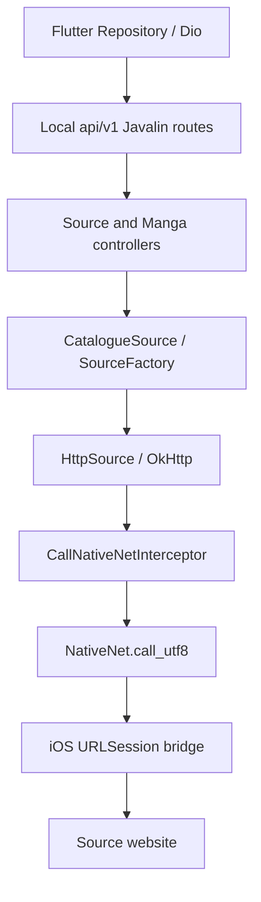

# Tachimanga 5.1 — تحليل خلفية Java/Kotlin

هذا تحليل للبايت كود المرفق داخل `MCHome.bundle/res.zip` في عينة 5.1، البناء 520.
بصمة الأرشيف الداخلي `db4443eadbeece65c628734d82826c91d1beb4e3d6efd3b5ef721342755b0aa6`.
لم يُشغّل أي صنف من العينة. الأدلة المنظمة في
[java-deep.json](../validation/rea/tachimanga-5.1-java-deep.json)، والتفكيك الكامل
المحدد لهذه الجولة محفوظ خارج مستودع التطبيق في `tachimanga-analysis-5.1/java-full/`.

## التغطية الفعلية

| المستوى | النتيجة |
|---|---:|
| مدخلات ZIP الداخلية | 33,213 |
| مدخلات class المقروءة بنيويًا | 27,688 / 27,688 |
| أخطاء محلل class | 0 |
| أسماء الأصناف المعلنة الفريدة | 26,578 |
| الطرق المعلنة | 213,202 |
| الطرق التي تحوي Code attribute | 201,921 |
| تعليمات البايت كود المفهرسة | 5,328,908 |
| المراجع المباشرة إلى أصناف/حقول/طرق | 1,396,444 |
| أصناف نطاق الخلفية/التوافق المختارة للتفكيك | 1,610 |
| ملفات Java الناتجة من CFR | 558، مع دمج أصناف داخلية |
| الأصناف المركزة في فحص العقود | 44 |

اختلاف عدد المدخلات عن الأسماء الفريدة يشمل 1,116 مدخلة multi-release، و1,110
أسماء مكررة بين إصداراتها. لا تُفسّر هذه الأعداد بوصفها إضافات مثبتة للمستخدم.
أعلى class version هو 61، الخاص بـJava 17؛ توجد تبعيات أقدم أيضًا.

استُخدم CFR 0.152 بحد heap قدره 768 MiB، ثم Vineflower 1.11.1 على 79 مدخلة
من ستة أصناف خارجية تعثر تفكيك بعض طرقها. بقيت 7 استثناءات طريقة و162 تحذيرًا
من إعادة تنظيم التدفق في CFR، و6 تحذيرات فشل في المرور الثاني. لم تُعامل هذه
المواضع كسورس صحيح؛ وُظف `javap` وفهرس تعليمات البايت كود للتحقق من المراجع
المباشرة والتواقيع. لا يثبت اجتياز المحلل البنيوي فهم سلوك جميع الطرق.

## الإقلاع ومدخل الخدمات

تستدعي طبقة iOS `suwayomi/tachidesk/MainKt.main(String[])`. النسخة الاصطناعية
من `main(String[])` تمرر إلى `main()`، ثم `main0()`، الذي يستدعي بالتتابع:

1. `ServerSetupKt.envSetup()`.
2. `ServerSetupKt.applicationSetup()`.
3. `JavalinSetup.javalinSetup()`.
4. `ServerSetupKt.applicationSetupExtra()`.

يعيد `JavalinSetup` إنشاء/تجهيز Javalin وفق الإعدادات ويبدأه باستخدام IP والمنفذ
المقروءين من ServerConfig. يسجل `GlobalAPI` و`MangaAPI` و`CloudAPI` تحت
`api/v1/`. يظهر في واجهة Flutter endpoint افتراضي `http://127.0.0.1:4567`.
المنفذ قابل للتغيير، ولم تُشاهد socket حية أو طلب شبكة من تشغيل العينة.

إذًا تتضمن الخلفية **خادم API محليًا داخل التطبيق**. ليست واجهة المصادر مجموعة
طرق Java تعيد سلاسل JSON بالشكل الذي افترضه runner التجريبي في MangaShelf.

## مسار المصدر من الواجهة إلى الموقع

الأجزاء المتصلة في الرسم مثبتة من طرق الخلفية والتسجيلات وتعليمات الاستدعاء
وقنوات iOS وliterals الواجهة. تنفيذ كل فرع على هاتف، ونجاح مصدر بعينه، لم يُختبرا.

يرث `CatalogueSource` واجهة `Source` ويحافظ على ABI لـKotlin suspend عبر
`Continuation`، وعلى جسور RxJava التي تعيد `Observable`. نماذجه تشمل
`SManga` و`SChapter` و`Page` و`MangasPage` و`FilterList`، وتدعم `SourceFactory`
التي تعيد عدة مصادر. تواقيع البايت كود محفوظة في `sourceApiDescriptors`.

من أمثلة التواقيع المؤكدة: `getId(): long` و`getName()/getLang(): String`،
و`getSearchManga(page, query, FilterList, Continuation): Object`،
و`fetchPageList(SChapter): Observable`. يجب فصل هوية الحزمة عن هوية المصدر؛
إنشاء صنف واحد والبحث باسم packageName لا يعيد هذا العقد.

## طبقة HTTP وNativeNet

`CallNativeNetInterceptor` يبني `NativeNet.Req` من URL والطريقة والرؤوس، ويكتب
جسم الطلب في `okio.Buffer` عند وجوده. يجمع عدة Cookie headers بفاصل `; `،
ويضيف Content-Type من جسم الطلب. يمرر الاختيار المتعلق بالتحويلات، ويضبط
`noCookie=true` و`followRedirects=false` عند تفعيل `CommonSwitch.ENABLE_NATIVE_COOKIE`؛
لا يُختزل معنى هذا الفرع إلى تخمين سياسة كوكيز عامة.

`NativeNet.call` يرمّز metadata بواسطة JsonMapper إلى UTF-8، ثم يستدعي:

`call_utf8(byte[], okio.Buffer): byte[][]`

تمثل المصفوفتان الراجعتان metadata وجسم الرد. حقول metadata المقروءة تشمل
`code` و`message` و`error` و`headers` و`currentUrl`، بينما الجسم ثنائي منفصل.
يعيد interceptor تركيب OkHttp Response، ويتعامل مع error كفشل I/O أو استجابة
cache-only وفق الفرع. يسجل profiler الكلفة عبر `x-native-cost`.

فُهرس أيضًا native `NativeChannel.call_utf8(byte[], byte[])` و
`NativeString.indexOf(String, String): int`. وجود 1,220 طريقة native في كل
التبعيات لا يعني أن كل طريقة يجب أن تُنفذ في الجسر الخاص بالتطبيق؛ يلزم تتبع
الطرق التي تستدعيها المصادر والتبعيات المختارة فعلًا.

## الاتجاه الآخر: JavaChannel وأحداث الخلفية

يعرض `MainKt.javaChannel(tag, content)` الطريقة `JavaChannel.call`، وتتضمن
فروعًا للأوامر `UPDATE:START` و`UPDATE:PULL` و`UPDATE:PULL2` و`UPDATE:STOP`،
و`DOWNLOAD:STOP` و`DOWNLOAD:PULL` و`PIP:PULL` و`SERVER:CHANGE_PORT`.
تعيد بعض الفروع نتائج serialized من نماذج حالة التحديث والتنزيل، وبعضها يبدأ
عملًا على coroutine scope. لا يثبت وجود هذه الفروع ترتيب تشغيلها أو جدولة iOS.

`NativeChannel` هو الاتجاه من Java إلى المضيف؛ يحول topic والمحتوى إلى UTF-8
ويستدعي JNI. تتبعت [دراسة iOS](TACHIMANGA-5.1-NATIVE-AR.md) استقبال الأحداث
المتعلقة بالتنزيلات والتحديثات وUser-Agent وToast والتسجيل.

## تثبيت الإضافات: APK وJAR

تحتوي العينة نفسها طريقتين منفصلتين: `prepareApkExtension` و
`prepareJarExtension`، مع إنهاء التثبيت بواسطة `installPreparedExtension`.
يتضمن مسار APK التحويل إلى JAR ومعالجة موارد/بايت كود. مسار JAR يقرأ
`AndroidManifest.xml` **كنص UTF-8 داخل ZIP** بواسطة `PackageTools.getPackageInfoFromJar`.

تُستخرج منه الحزمة والإصدار وميزات التطبيق وmetadata، ومنها
`tachiyomi.extension.class` و`tachiyomi.extension.factory`. إذا بدأ اسم الصنف
بنقطة، يُكمّل باسم الحزمة. يستخدم `loadExtensionSources0` ClassLoader مع
اختيار `app.tachimanga.childfirst`، ثم يبحث عن الصنف وينشئه، وبعدها يميز المصدر
المباشر عن `SourceFactory` ويجمع مصادره.

يحفظ الخلفية معلومات `installPathType` وclassFQName وحزمة المصدر. لا يثبت هذا
التحليل توقيع كل إضافة أو سلامتها أو نجاحها. لم تُنزّل أو تُشغّل إضافات فعلية في
هذه الجولة، ولم تُعامل قراءة اسم الصنف من manifest كقرار ثقة.

## المستودعات وعقد Protobuf

استُخرجت أرقام الحقول من annotations في أصناف العينة، بما فيها serializers:

| الرسالة | الحقول المؤكدة |
|---|---|
| NetworkExtensionStore | name=1، badgeLabel=2، signingKey=3، contact=4، extensionList=101، extensionListUrl=102 |
| ExtensionList | extensions=1 |
| Extension | name=1، packageName=2، resources=3، extensionLib=4، versionCode=5، versionName=6، contentWarning=7، sources=8 |
| Resources | apkUrl=1، iconUrl=2، jarUrl=501 |
| Source | id=1، name=2، language=3، homeUrl=4، mirrorUrls=5، message=7 |

هذه الحقول لا تجعل APK قابلًا للتشغيل على iOS تلقائيًا، ولا تثبت مصادقة
signingKey لمجرد قراءته. طريقة جلب/تحديث الفهرس وقرارات التحقق والاسترجاع
تتضمن coroutines تعثر بعض تفكيكها؛ يلزم حسم كل فرع من البايت كود قبل نسب سياسة
أمنية أو fallback كاملة للتطبيق.

## API والبيانات والتنزيلات والنسخ

استُخرجت 124 عملية تسجيل route من `MangaAPI` في هذا النطاق، مع HTTP method
والمجموعة والمسار وcontroller والـhandler. يشمل الفهرس source وmanga وchapter
وextension وrepo وdownload وupdate وhistory وcategory وtrack وsync وغيرها.
ليس العدد جردًا شاملًا لكل route في `GlobalAPI` و`CloudAPI` أو WebSocket.

من المسارات المؤكدة: `source/list` و`source/listForSearch`، و
`source/{sourceId}/popular/{pageNum}`، وتثبيت/تحديث/إزالة الإضافات؛ الفهرس
الكامل في `apiRoutes` بالدليل المنظم. لا يعني التسجيل أن route متاح دون شروط
أو أن حسابًا/جلسة/مصدرًا معينًا سينجح عليه.

تتصل `DBManager` بقاعدة SQLite عبر Exposed وJDBC، بالمسار `dataRoot/sqlite8.db`
ومعامل `transaction_mode=IMMEDIATE`. تتضمن ترحيلات العينة
`M0031_Extension_InstallPathType` و`M0032_ExtensionStore`، إلى جانب جداول
العناوين والفصول والمصادر والتصنيفات والتقدم والتتبع. هذه بنية الكود؛ لم تُقرأ
قاعدة مستخدم فعلية أو يُختبر ترحيل بياناتها.

للتنزيل مدير وطابور وcoroutines وحالة `Stopped=0` و`Running=1` و`Paused=2`،
وربط مع حالة مهام iOS. بقيت طريقة في Downloader ضمن أخطاء التفكيك، لذلك لا
يُعلَن اكتمال فهم حالات الإلغاء والاستئناف أو استمرار المهمة بالخلفية.

يوجد مسار نسخ Protobuf: `ProtoBackupExport` يكوّن Backup ثم يرمزه إلى bytes
ويكتبه عبر GzipSink، ويستخدم اسمًا ينتهي `.tachibk`. تشمل نماذجه العناوين
والفصول والمصادر والتصنيفات والتقدم/التاريخ والتتبع وفق BackupFlags. وجوده لا
يجعل `.tmb` المسجل في iOS مساويًا لهذه الصيغة؛ توجد طبقات نسخ أخرى، ويلزم
فحص عقد كل صيغة بعينها. مسارات الاستيراد تستعيد معلومات المصادر وتربطها، ولا
تثبت استعادة كل إضافة أو صورة من مجرد نجاح decode.

## مقارنة السورس العام بالعينة

راجعت الدراسة السورس العام المثبت عند `2e52214106ffab02d13ff61a620def78414a8a45`.
يتشارك مع العينة أسماء وبنى كثيرة، لكنه يفتقد مسار JAR الأصلي وطرق
`prepareJarExtension` و`finalizeJarExtension` و`getPackageInfoFromJar`، وترحيلات
البيانات الجديدة المذكورة. سُجلت بصمات الملفات المقارنة في الدليل.

لذلك يساعد السورس العام في فهم التبعيات والعقود، ويحتاج مقارنة وإكمالًا محددًا
للنسخة 5.1. لم تُستعد شجرة Kotlin الأصلية أو build.gradle الأصلي من هذا التشابه.

## حدود الفهم ودلالته على MangaShelf

تحتوي 2,577 فئة و26,862 طريقة على literal `Stub!` في البايت كود المفهرس.
هذا مؤشر على وجود stubs في التبعيات، وليس إثبات أن كل Android API مطلوب
مطَبّق. يجب تعيين مسارات التوافق التي يستخدمها المصدر المختار فعلًا.

أصبح لدينا فهرس كامل للأصناف وطرفا ABI ومسار إقلاع وAPI محلي وعقد تثبيت
JAR ومخطط فهرس مثبت من العينة. يبقى حل مواضع تفكيك coroutines الصعبة، وسياسات
التحقق/الاسترجاع التفصيلية، وسلوك كل مصدر وحساب ومهمة ونسخة احتياطية على جهاز.
لا تقوم اختبارات JSON الاصطناعية الحالية في MangaShelf مقام هذه الخلفية.
