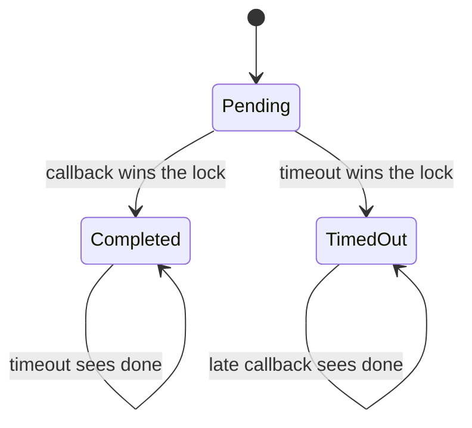

# Tachimanga 5.1 — ذاكرة JNI والمهلة والردود

متابعة ساكنة لعينة 5.1/520. بصمة المضيف:
`cd03850d680069f43dd58df4b3426ec37bc5f55f613854a8d665d0fccba60e08`.
العناوين هنا عناوين ARM64 الأصلية قبل ASLR. لم يُشغّل أي جزء من العينة.

## مطابقة ABI وتصحيح ملف Ghidra

طابقت مواضع جدول JNI مع
[رأس OpenJDK 17.0.15](https://github.com/openjdk/jdk17u/blob/jdk-17.0.15%2B6/src/java.base/share/native/include/jni.h)،
وبصمته `1266aea5b9f5d5db1cb6f8e5c6c43cfa7f80bc4f72d7fe42c6131bb939dc70f4`.
فُهرس 234 موضعًا، وتطابقت أسماء المواضع المشتركة مع الرأس المحلي. عرض المؤشر
8 بايت مطابق لـARM64؛ هذا لا يثبت نجاح استدعاء في runtime.

حُلّت 18 تعليمة JNI غير مباشرة في ثلاثة helpers، مع تتبع aliases لمعامل env
وفحص تعليماتها يدويًا. الدليل:
[jni-memory.json](../validation/rea/tachimanga-5.1-jni-memory.json).

اختار Ghidra في الاستيراد السابق compiler spec باسم `swift` تلقائيًا للمضيف
المختلط. لذلك لم تكن أنواع وقيم إرجاع pseudocode القديمة كافية لإثبات الذاكرة.
أُعيد الاستيراد بـ`AARCH64:LE:64:AppleSilicon:default` واتفاقية C، مع تعريف أنواع
JNI وقائمة من 59 prototype لرموز C وstubs مختارة. عُيّن تخزين معاملات ObjC في x0 ثم
x2 فما بعده، دون اعتبار x1 معاملًا يمرره المستدعي إلى selector stub.

نتجت خمسة ملفات pseudocode ناجحة: ByteArrayToUTF8 وParseNetRequest و
BuildNetResponse وNativeNet وNativeNetCompletion. أربعة منها نسخ محسنة لدوال
مفحوصة سابقًا، والـcallback مدخل إضافي. نجح compile السكربت المؤلف واجتازت
ملفات status الخمسة؛ exit 0 لاستيراد Ghidra وحده لا يكفي، لأن محاولة compile
سابقة أخفقت رغم نجاح الاستيراد. حُفظت سجلات الفشل والنسخة السابقة كما هي.

الـprototypes هنا تعليقات تحليلية مؤلفة وليست debug symbols مستردة من المصدر.
ما زالت بعض تحذيرات thunks والأنواع المفقودة؛ التعليمات الأصلية مرجع التدفق،
ولم تُعتبر ملفات C مشروعًا أصليًا أو إثبات تكافؤ تشغيل.

## الطلب: نسخ قبل تحرير المخزن

### Metadata وNativeChannel

الـhelper عند `0x100008de8` يقرأ طول byte[] بواسطة GetArrayLength عند
`0x100008e10`، ويحجز مخزن C بطول len+1، وينسخ إليه بواسطة GetByteArrayRegion
عند `0x100008e48`، ويضيف NUL، ثم ينشئ NSString ويحرر **مخزن C الخاص به** عند
`0x100008e70`. لا يحرر مصفوفة Java ولا يستعمل GetByteArrayElements لهذا النص.

ParseNetRequest عند `0x10004e80c` يستعمل النمط نفسه للـmetadata: النسخ عند
`0x10004e88c` والتحرير عند `0x10004e8b4`، ثم parsing JSON. null input أو فشل
malloc يعيدان nil في الفرع المفحوص؛ النص `throwex_outofmemory` يُطبع بواسطة
puts، وليس دليلًا على رمي استثناء Java.

### جسم الطلب

عندما يكون كائن Okio غير null، يكون المسار:

| الخطوة | موضع النداء |
|---|---|
| GetObjectClass لكائن Buffer | `0x10004eaac` |
| GetMethodID لـreadByteArray بتوقيع `()[B` | `0x10004ead0` |
| CallObjectMethod للحصول على byte[] | `0x10004eae8` |
| GetArrayLength | `0x10004eb00` |
| GetByteArrayElements | `0x10004eb1c` |
| NSData.dataWithBytes:length: | `0x10004eb64` |
| وضع NSData في HTTPBody | `0x10004eb7c` |
| ReleaseByteArrayElements بالوضع 2 | `0x10004eb98` |

دالة NSData المستعملة تنسخ البايتات وفق
[توثيق Apple](https://developer.apple.com/documentation/foundation/nsdata/datawithbytes%3Alength%3A).
والوضع 2 هو JNI_ABORT، الذي يحرر النسخة المؤقتة دون إعادة نسخ تعديلات إلى Java؛
عند pin مباشر يبقى معنى التحرير لدى VM، لا free يدويًا للمؤشر.
[مرجع JNI](https://docs.oracle.com/en/java/javase/17/docs/specs/jni/functions.html#releaseprimitivetypearrayelements-routines).
لذلك لا يظل pointer الخاص بعناصر Java هو مخزن HTTPBody في المسار المفحوص.

لا يظهر حد حجم خاص في هذه helpers قبل الحجز، ولا تظهر ExceptionCheck ضمن
نداءات JNI المفهرسة فيها. لم يُختبر OOM أو فشل GetMethodID أو exception pending؛
نجاح النسخ في المسار المعتاد لا يثبت سلامة كل مسار فشل.

## المهلة: حالة مشتركة يحسمها القفل

### قيمة timeout الفعلية

`MCUtil.getTimeoutIntervalForRequest` عند `0x10002e850` يقرأ قيمة cached بعد
تهيئة dispatch_once. global block الخاص به عند `0x1008af628` يشير إلى
initializer عند `0x10002e880`.

القيمة الأولية في ملف المضيف هي **15 ثانية**: int32 عند `0x10096e560`، إزاحته
في الملف `0x96e560`. يقرأ initializer مفتاح UserDefaults
`flutter.config.nativeReqTimeout` عند `0x10002e8ac`، ويقبل قيمة NSNumber إذا
كان intValue لها **11 أو أكثر** عند `0x10002e900`. لا يظهر حد أعلى في هذا
الـinitializer. لا يثبت اسم المتغير في NSLog أن خدمة بعيدة غيرتها للمستخدم.

تقرأ جلسة النقل القيمة نفسها، بينما انتظار semaphore في NativeNet يستعمل
`timeout + 3`، أي **18 ثانية بالإعداد الأولي**، عبر dispatch_time ثم wait عند
`0x10004f460`. إعداد timeout للجلسة ليس دليلًا على مهلة كلية لكل حالات نقل
URLSession، والقيمة الفعلية قد تتغير قبل أول قراءة بسبب الإعدادات.

### ربط الحالة بالـcallback

NativeNet عند `0x10004f1c8` ينشئ:

- NSObject للقفل وsemaphore.
- byref boxes للبيانات وresponse وerror والكلفة وعلامة done.
- completion block عنوانه `0x10004f880`؛ يلتقط القفل والـsemaphore والطلب
  والـboxes وزمن البدء. لا يوجد JNIEnv ضمن هذه الحقول المحددة.

| المسار | التدفق المثبت |
|---|---|
| callback | يدخل القفل عند `0x10004f908` ويفحص done؛ إذا حُسمت النتيجة يخرج دون استبدالها |
| إكمال عادي | يحفظ data/response/error بواسطة objc_storeStrong عند `0x10004f954` و`0x10004f968` و`0x10004f97c`، ثم يضبط done عند `0x10004f998` |
| إيقاظ المنتظر | يخرج من القفل ثم semaphore_signal عند `0x10004f9b0` |
| انتهاء انتظار JNI | ينشئ NSError برسالة Receive timeout، ويدخل القفل، ويفحص done عند `0x10004f4ec` |
| المهلة تسبق الإكمال | يمسح data/response، ويحفظ الخطأ ويضبط done عند `0x10004f54c`، ثم يلغي task عند `0x10004f5a8` |
| الإكمال سبق قفل المهلة | يتجاوز مسار كتابة timeout ويستعمل النتيجة المكتملة |
| قراءة النتيجة | يأخذ snapshot من القيم مع retain تحت القفل عند `0x10004f5c4`..`0x10004f604`، ثم يبني رد JNI خارج القفل |

هذا يثبت سياسة عدم استبدال النتيجة بعد حسمها في الدالتين المحددتين. لا يثبت
انعدام deadlock أو memory leak في كل طبقات URLSession أو OpenJ9 أو hooks،
ولا أن خيط UI لا يمكنه الوصول إلى نداء JNI المتزامن عبر مسار آخر.

## الرد: مصفوفتان مملوكتان لـJava

BuildNetResponse عند `0x10004eca0` يجد الصنف `[B` عند `0x10004ed1c`، ثم ينشئ
object array بطول 2 عند `0x10004ed38`.

- الخانة 0: JSON metadata؛ NewByteArray عند `0x10004f084` ثم SetByteArrayRegion
  عند `0x10004f0c4` وSetObjectArrayElement(index 0) عند `0x10004f0e4`.
- الخانة 1: جسم الرد الثنائي إن كان NSData غير null؛ الإنشاء عند `0x10004f104`
  والنسخ عند `0x10004f144` والإسناد index 1 عند `0x10004f164`.

تُنقل bytes إلى مصفوفات Java، فلا يعاد pointer إلى مخزن NSData لتملكه Java.
تُبنى هذه المصفوفات على خيط نداء JNI بعد الانتظار؛ callback نفسه يتعامل مع
كائنات iOS والـboxes المحددة، وليس مع env محفوظ من خيط Java.

المصفوفة الخارجية تبدأ بخانات null. nil body يختلف عن NSData موجودة طولها صفر.
هناك فحوص فشل تخصيص المصفوفات، لكن لم يُختبر كيف يصل كل OOM أو JNI exception
إلى Java. لا يُعلن ضمان كامل لملكية الذاكرة من فحص المسار المعتاد فقط.

## السياسات الدقيقة للرؤوس والكوكيز والردود

- followRedirects الافتراضي true إذا لم تكن القيمة NSNumber؛ noCookie الافتراضي false.
- عند noCookie=false يصل parser إلى helper `0x10004e5cc`. إذا كان الطلب
  يحمل Cookie غير فارغ وكانت sharedHTTPCookieStorage تعيد cookies للـURL،
  يجمع النص الموجود والجديد بفاصل `; `. لا توجد إزالة تكرار أسماء cookies
  في هذا helper، ولا يغطي وحده سياسة الجلسة عندما لا يوجد Cookie صريح.
- helper `0x10004e744` يزيل Content-Encoding وcontent-encoding عند قيمة
  مساوية حرفيًا لـgzip أو br أو deflate؛ لا يثبت ذلك دعم كل سلسلة encodings.
- تضاف x-native-cost. عند اتباع التحويلات واختلاف URL الأصلي والحالي، يضاف
  currentUrl. توجد معالجة خاصة محدودة لاسم موقع وصفحة تحقق؛ ليست سياسة عامة لكل مصدر.
- يضيف helper error عند NSError؛ لا يضع code=500 لكل خطأ. طبقة NativeNet.java
  تعيد 500 فقط في مسار metadata null المحدد، وتقرأ metadata/body من الخانتين.
- CallNativeNetInterceptor يحول error إلى IOException؛ إن كان الطلب onlyIfCached
  يعيد 504 بدلًا من ذلك. وعند currentUrl يبني priorResponse برمز 302 ويغير
  URL الطلب في الرد. هذا تمثيل أعيد بناؤه، وليس تسجيلًا لكل قفزة redirect فعلية.

## JavaChannel: مسار نص وخيط مختلف

helper `0x10002a450` يقرأ VM المحفوظ تحت pthread rwlock، ثم يستدعي
AttachCurrentThread عبر JavaVM slot `0x20` عند `0x10002a4b0`.
يحصل على MainKt بواسطة helper `0x10002a668`: FindClass ثم NewGlobalRef ثم
DeleteLocalRef. تخزن class وmethodID في متغيرات عامة.

| العملية | موضع النداء |
|---|---|
| GetStaticMethodID لـjavaChannel(String,String):String | `0x10002a520` |
| NewStringUTF للمعاملين | `0x10002a540` و`0x10002a55c` |
| CallStaticObjectMethod | `0x10002a580` |
| GetStringUTFChars | `0x10002a5a0` |
| strdup لامتلاك رد C مستقل | `0x10002a5ac` |
| ReleaseStringUTFChars | `0x10002a5c8` |
| DeleteLocalRef للمعاملين والرد | `0x10002a5dc` و`0x10002a5f0` و`0x10002a604` |
| DetachCurrentThread | `0x10002a614` أو مسار الفشل `0x10002a640` |

هذا المسار يستعمل modified UTF-8 في JNI، بينما NativeNet وNativeChannel
يستعملان byte[] بترميز UTF-8 في Java. يجب التمييز بين العقدين عند نقل emoji
وNUL؛ لم يُرصد فشل حرف بعينه في التطبيق. [عقد النصوص في JNI](https://docs.oracle.com/en/java/javase/17/docs/specs/jni/functions.html#newstringutf).

لا توجد خطوة GetEnv ظاهرة في helper قبل attach، ولا حالة محلية تسجل أنه هو
الذي ألحق الخيط أول مرة. لا يثبت detach غير المشروط نجاح فصله، ولا سلامة
إعادة الدخول من خيط عليه Java frames. كما لم يُثبت من helper وحده أمان سباق
تهيئة caches أو تدمير VM أثناء النداء.
ملكية env تخص الخيط، وdetach له قيود موثقة في
[Invocation API](https://docs.oracle.com/en/java/javase/17/docs/specs/jni/invocation.html#attachcurrentthread).

## متطلبات MSL الناتجة

- تنسيق metadata والجسم منفصلان، مع نقل bytes وملكية واضحة وحجم محدود.
- إكمال مرة واحدة تحت قفل، وإلغاء task وتجاهل callback المتأخر دون إعادة الطلب.
- فحص JNI exceptions/null عند كل حد قابل للفشل، وحفظ env على خيطه فقط.
- إدارة attach/detach حسب الملكية، وحماية عمر VM وglobal refs وmethod caches.
- اختبار UTF-8/UTF-16/modified UTF-8 بالعربية وemoji وNUL، وفشل التخصيص والمهلة
  وإغلاق المحرك أثناء طلب كبير. نجاح fixture ASCII لا يثبت هذه الحالات.

لا يعلن هذا التقرير نجاح المصادر على iPhone؛ هو عقد تنفيذ مدعوم بالتعليمات
والأنواع وتصحيح ملف تحليل Ghidra، مع أسئلة تشغيل محددة باقية.
