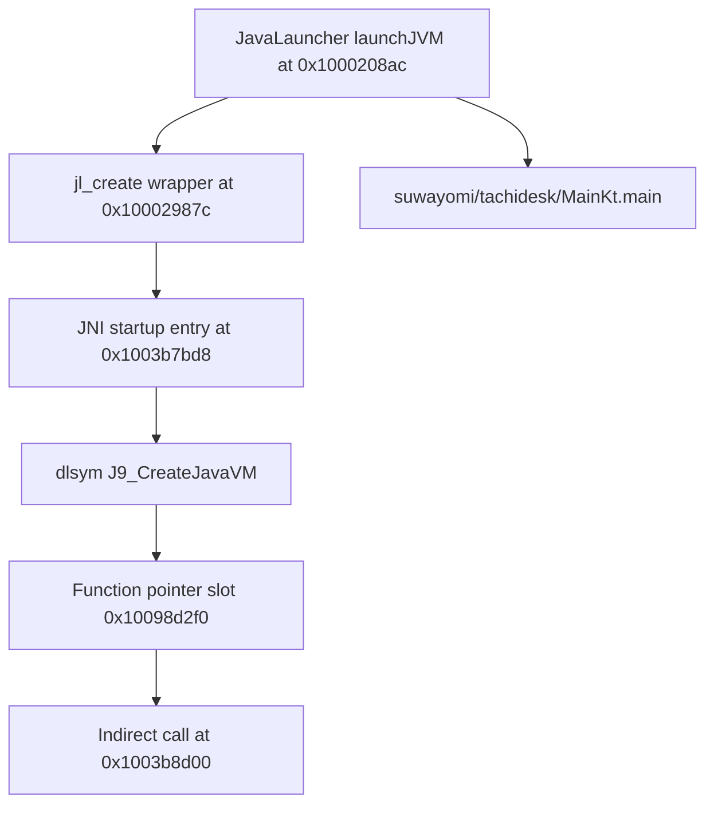

# التحليل الأصلي لـTachimanga 5.1 — الإقلاع وجسور iOS

تاريخ الفحص: 20 أكتوبر 2026. هذا تقرير تحليل ساكن للعينة المقدمة، الإصدار 5.1
والبناء 520، وليس استعادة للسورس الأصلي أو إثبات تشغيل التطبيق. لم يُنفذ التطبيق
أو أي JAR أو dylib من العينة. أعيد استخدام جرد REA ونتائج محاولتي Ghidra، ثم
فُكّت المؤشرات والتعليمات بأدوات قراءة مستقلة بعد أخطاء المحللات السابقة.

الدليل المنظم: [native-deep.json](../validation/rea/tachimanga-5.1-native-deep.json).
ملفات التفكيك والسكربتات والجداول الكاملة خارج مستودع التطبيق، تحت
`/home/user/Documents/Managa-app/tachimanga-analysis-5.1/native-full/`.

## الهوية والتغطية

| الملف | الحجم | SHA-256 |
|---|---:|---|
| IPA الأصلي | 133,786,072 | `e8e3ab5152a85f60d5d617bae825d39be7d55e3f048661f3042def0009a51863` |
| المضيف `Tachimanga` | 10,485,760 | `cd03850d680069f43dd58df4b3426ec37bc5f55f613854a8d665d0fccba60e08` |
| `Frameworks/Tachimanga.dylib` الإضافية | 5,990,608 | `96a70d5117449bf38732b4d601d6ce00a6291314cb698841c731272a6d69359d` |

فك المحلل 67,428 مؤشرًا من النوع `DYLD_CHAINED_PTR_64_OFFSET`، وهو العدد نفسه
الذي سجله محمل Ghidra سابقًا، دون أخطاء في فك البنية. استُخرجت 683 فئة
Objective-C و7,880 تنفيذًا من قوائم الفئات وmetaclasses، و29,491 بداية دالة من
`LC_FUNCTION_STARTS`. لا تشمل هذه الأعداد فئات categories أو متطلبات البروتوكولات.

مُسح قسم `__text` كله: من `0x100004000` إلى `0x100702f64`، على دفعات محدودة.
شملت نتيجة Capstone عدد 1,833,945 وحدة مفكوكة مع تجاوز 352 بايت تعذر فكها؛
قد توجد بيانات مضمنة في القسم. جمع المسح 86,250 إشارة عنوان ضمن بحث ADRP محدود
بعشر تعليمات وفحص تغيّر المسجل، وليس تحليل تدفق شاملًا. وحُددت 186,542 تعليمة
BL أو B تعبر حدود دالة بوصفها مرشحات ساكنة. لا تمثل هذه الأعداد رسم استدعاءات
كاملًا: Objective-C وJNI ومؤشرات الدوال تحتاج تتبعًا منفصلًا.

العناوين أدناه عناوين الصورة قبل ASLR. قاعدة المضيف `0x100000000`. في نطاقات
`__TEXT` المفحوصة يمكن إثبات الإزاحة من خريطة القطاعات؛ ليست العناوين إزاحات
ملف عامة. جميع ادعاءات التدفق التالية تخص الدوال المحددة في الجداول.

## إقلاع JVM: مسار فعلي في التعليمات

لم نعد نعتمد على مجرد وجود اسم `_J9_CreateJavaVM` في جدول الرموز. ظهر المسار:

| الملاحظة | العنوان/موضع الاستدعاء | الثقة |
|---|---|---|
| `+[JavaLauncher launchJVM:]` | `0x1000208ac` | عالية؛ طريقة من metadata وتعليماتها |
| استدعاء wrapper إنشاء VM | `0x1000210f8` → `0x10002987c` | عالية؛ BL مباشر |
| wrapper يستدعي مدخل JNI | `0x1000299e0` → `0x1003b7bd8` | عالية؛ BL مباشر |
| `dlopen(NULL, 0x100)` لحيز العملية | `0x1003b8054` | عالية؛ معاملات وتعليمة استدعاء |
| حل `J9_CreateJavaVM` بـ`dlsym` | `0x1003b8068` | عالية؛ الاسم ومعاملات النداء |
| حفظ النتيجة | `0x1003b8074`، الخانة `0x10098d2f0` | عالية؛ store صريح |
| تحميل الخانة واستدعاؤها | `0x1003b8cec` ثم `0x1003b8d00` | عالية؛ load ثم BLR |
| تنفيذ الاسم المطابق في الصورة | `_J9_CreateJavaVM` عند `0x1002b1654` | عالية لوجود التصدير؛ ربط وقت التشغيل غير مشاهد |

هذا يثبت منطق حل الرمز ثم استدعاء مؤشره داخل الملف. لا يثبت ما سيعيده `dlsym`
في عملية معدلة، أو أن إنشاء VM ينجح على جهاز، أو إعدادات الذاكرة الفعلية أثناء
التشغيل. يحل المسار أيضًا `J9_GetCreatedJavaVMs` وواجهات `omrthread_*` و`j9port_*`
من حيز العملية. بنية المضيف هنا OpenJ9، ولا يُستنتج من ذلك أن محرك Zero التجريبي
في MangaShelf يملك السلوك نفسه.

## المسارات والخيارات التي يبنيها المضيف

تثبت التعليمات داخل `launchJVM:` هذه القرارات:

- يبني Java home من `NSBundle.mainBundle.bundlePath` ثم `jre`، عند `0x10002092c`.
- يختار `jarPath` غير الفارغ في مدخل الإقلاع، وإلا يستخدم
  `resourcePath/MCHome.bundle/res.zip`؛ يبدأ الفرع عند `0x1000209d8`.
- يضع `OPENJ9_JAVA_OPTIONS=-Dcom.ibm.tools.attach.enable=no` باستدعاء `setenv`
  عند `0x100020960`، و`_JAVA_LAUNCHER_DEBUG=1` عند `0x100020978`.
- يبدأ بحجم `-Xms128M`، ويمكن استبداله بقيمة `flutter.config.xms` ذات السابقة
  `-Xms`؛ ويبدأ بحد `-Xmx256M`، ويمكن استبداله بقيمة `flutter.config.xmx`
  ذات السابقة `-Xmx`. فحص السابقة وحده لا يثبت قبول VM للقيمة.
- يضيف `-Xint` و`-Djava.compiler=NONE` عند `0x100020c44` و`0x100020c54`.
  هذه خيارات تشغيل مفسر، ولا تثبت وحدها خلو جميع ملفات التوزيع من JIT.
- يضيف `-XX:-UseCompressedClassPointers` و`-Xshareclasses:none`
  و`-XX:-OpenJ9CommandLineEnv` و`-Xdump:heap:none` و`-Xdump:snap:none`.
- يضبط `user.dir` و`user.home` من مجلد المستخدم، و`java.home` من `jre`،
  ويضيف timezone النظام ما لم تكن قيمة `flutter.config.set_timezone` هي النص `1`.
- يمرر `app.tachimanga.skipInit` و`cleanDb` و`vacuum` كـ0/1، و`childfirst`
  من إعداد الإقلاع. يفصل `flutter.config.joptions` بالمسافة ويهمل الأجزاء الفارغة؛
  لا يظهر في هذا المقطع parser لاقتباسات shell.
- يضيف `-Djava.class.path=...` ثم يحول الخيارات إلى UTF-8 ويستدعي wrapper.

الجدول الآلي يحفظ موضع كل خيار، لتجنب نسب سلاسل تخص داخل OpenJ9 إلى إعدادات
التطبيق. wrapper يضبط قيمة JNI `0x00010008`، ويستخدم حالة VM محفوظة، ويرفض
إعادة إنشائها بعد علامة التدمير. هذا وصف للتعليمات وليس اختبار دورة حياة.

## مدخل Java وإدارة الخلفية

بعد إنشاء VM، يطلب المضيف الصنف `suwayomi/tachidesk/MainKt` والطريقة `main`
بتوقيع `([Ljava/lang/String;)V`، عبر helper عند `0x100029bc8` وموضع استدعاء
`0x100021184`. توجد معالجة صريحة لرسالة فشل المحرك ورسالة فشل الخلفية.

ويستعمل المضيف الصنف نفسه لهذه الطرق:

| wrapper في iOS | بدايته | طريقة Java/التوقيع |
|---|---|---|
| `startServer` | `0x1000213f4` | `startServer()V` |
| `stopServer` | `0x100021438` | `stopServer()V` |
| `startSocket` | `0x10002147c` | `startSocket()V` |
| `waitRequestDone` | `0x1000214c0` | `waitRequestDone()V` |
| `stopSocket` | `0x100021504` | `stopSocket()V` |

helper النداء يحتوي مسارات التحقق من وجود VM والصنف والطريقة، وتوقيع مدعوم،
وإرفاق الخيط، وlocal frame، وcontext class loader، وإنشاء مصفوفة arguments،
وفصل الخيط. لم تُختبر هذه المسارات. لا يعني وجود wrappers أن كل استدعاء يحصل
بذلك الترتيب على جهاز.

## NativeChannel: Java إلى iOS

الدالة المصدرة عند `0x100008d44` تستقبل معاملي byte arrays، وتحولهما بواسطة
helper `0x100008de8` في موضعي `0x100008d70` و`0x100008d88`. يقرأ helper
طول المصفوفة وبياناتها عبر جدول JNI، وينشئ سلسلة UTF-8 بعد إضافة NUL، ثم يحرر
المخزن الأصلي. لم يُختبر سلوك NUL مضمن أو UTF-8 تالف.

بعد ذلك تستدعي `MCNativeChannelPlugin.instance`، وترسل `handle:content:` عند
`0x100008db8`. تنفيذ الطريقة عند `0x10000e1e0` يحتوي فروعًا واضحة:

| topic | موضع مقارنته/النداء | الوجهة |
|---|---|---|
| `LOG_EVENT` | `0x10000e22c` / `0x10000e244` | `logEvent:` |
| `USERAGENT:DEFAULT` | `0x10000e250` / `0x10000e27c` | `MCUserAgentPlugin.updateDefaultUserAgent:` |
| `TOAST:JSON` | `0x10000e288` | تحويل `MCToastModel` ثم block على main queue |
| `DOWNLOAD:START` أو `UPDATE:STATUS` | `0x10000e37c` / `0x10000e390` | `MCContinuedTaskPlugin.onNativeChannel:content:` عند `0x10000e3c0` |

هذا نطاق هذه الطريقة، وليس جرد جميع topics في Java أو Dart. يوجد اتجاه آخر
من iOS إلى Java: `+[JavaLauncher javaChannel:content:]` عند `0x10002155c` يحول
السلسلتين إلى UTF-8 ويستدعي helper `0x10002a450` عند `0x1000215c0`، ثم يحول
النتيجة إلى NSString ويحررها. تفاصيل helper الداخلية قيد التتبع.

## NativeNet: طلب حقيقي وcallback أصلي

الدالة المصدرة عند `0x10004f1c8` تستدعي parser الطلب `0x10004e80c` عند
`0x10004f23c`. تظهر فيه مفاتيح `url` و`followRedirects` و`noCookie`
و`headers` و`method`، ونداء Java `readByteArray` بتوقيع `()[B` لجسم Okio.

يستخدم المسار `MCURLSession.instance`، وينشئ
`dataTaskWithRequest:completionHandler:` عند `0x10004f41c`، ثم `resume`
عند `0x10004f43c`. يتحول النقل غير المتزامن إلى انتظار JNI متزامن بواسطة
semaphore عند `0x10004f460`. يُحسب حد الانتظار من قيمة timeout مع إضافة
ثلاث ثوان. يوجد مسار `Receive timeout` وإلغاء المهمة، ومزامنة وصول callback.
لا يثبت الفحص سلامة جميع السباقات أو حدود الذاكرة.

تتجمع النتيجة في helper `0x10004eca0`، المستدعى عند `0x10004f63c`. تظهر حقول
`code` و`message` و`headers` و`currentUrl` و`error`. توجد فروع خاصة بأسماء مصدر
وأخطاء، لذا لا نعلن أن العقد مجرد تمرير HTTP عام أو أن كل redirect/cookie policy
أُعيد فهمها. تظل معالجة JNI لكل فشل، وملكية buffers، وكل مسارات الإلغاء والتشفير
وWebView أمورًا تحتاج إتمامًا مستقلًا.

## مدخل Flutter

`-[ViewController initMethodChannel]` عند `0x10001ab78` ينشئ قناتين بواسطة
`FlutterMethodChannel.methodChannelWithName:binaryMessenger:`:

| الاسم | موضع الإنشاء | التسجيل/الحفظ |
|---|---|---|
| `MAGIC_PIPE` | `0x10001abcc` | `setMethodCallHandler:` عند `0x10001ac48`، عنوان block `0x10001ad34` |
| `MC_NOTIFY` | `0x10001acd0` | تحفظ في `MCFlutterPlugin.notifyChannel` عند `0x10001acf8` |

القناة الأولى محفوظة أيضًا في `MCFlutterPlugin.methodChannel`. هذه تسجيلات
مثبتة بتعليمات وإشارات strings. تأكدت أسماؤها وترميزها مستقلًا من كائنات
MethodChannel في [Flutter AOT](TACHIMANGA-5.1-FLUTTER-AR.md)، مع ربط فروع
النسخ والخلفية والتنزيل في [تقرير المنصة](TACHIMANGA-5.1-PLATFORM-AR.md).

## مكتبة التعديل منفصلة عن المضيف

يحمل الملف الإضافي `Frameworks/Tachimanga.dylib` install name:
`/Library/MobileSubstrate/DynamicLibraries/Tachimanga.dylib`. يحتوي 2,046 chained
pointer، و109 imports، وثماني فئات Objective-C؛ قوائمها الثابتة تكشف ثماني طرق
`initialize` فقط، رغم وجود selectors أخرى مثل `updatePremiumhnhtv:`.

أظهر مسح تعليمات BL الفعلية إلى stubs المستوردة 52 موضعًا لـ`class_replaceMethod`
وأربعة لـ`method_setImplementation` وموضعًا لـ`class_addMethod`. توجد أيضًا
استدعاءات `objc_getClass` و`sel_registerName`. لذلك تحتوي المكتبة منطق تغيير
methods، لكن تحديد كل class/selector/body المعدل يحتاج تحليل تدفقها وتمريراتها
المشفرة أو المبنية وقت التشغيل. اسم selector وحده لا يثبت ماهية التعديل أو
النتيجة المعروضة. لا تُنسب هذه المكتبة أو سلوكها للتوزيع الرسمي.

فُحصت أيضًا المكتبة الثانية `blatantsPatch.dylib`: حجمها 70,848 بايت، وبصمتها
`4fb1f1d688a795bd3fb63aec01cf238ed48834fb95733cdaa280ee0618401f5a`.
فُكّت 104 fixups و50 imports و23 بداية دالة و6 رموز، دون أخطاء بنيوية.
تظهر createDirectoryIfNotExists وgetAppGroupPathIfExists وrebindSecFuncs،
ومراجع Keychain وapp groups وCloudKit. لا توجد فئات ObjC مسجلة في نطاق
المحلل، ولا تثبت الأسماء وحدها كل آثار hooks. وجود مكتبات تعديل يعني أن مقارنة هذه
العينة بتوزيع رسمي مطابق تظل لازمة لتمييز السلوك الأصلي من المعدل.

## ما بقي مفتوحًا

اكتمل تتبع المسار المحدد لإعداد VM وحل J9 واستدعائه، ومدخل Java، وتسجيل قنوات
Flutter، ومسار NativeChannel المحدد، والهيكل الأصلي لطلب NativeNet. هذا تقدم
في فهم التنفيذ الفعلي، ويحل محل الاكتفاء بفهرسة أسماء هذه الرموز.

نجحت لاحقًا استراتيجية Ghidra مختلفة: استيراد read-only دون auto-analysis،
وبذور لدوال محددة وحد 30 ثانية للدالة وheap بحجم 1,200 MiB. أُخرج C pseudocode
لـ14/14 مدخلًا، منها LaunchJVM وNativeNet وNativeChannel ومعالج MAGIC_PIPE
وJavaChannel ومعالجا المهام المستمرة. [النتائج والبصمات](../validation/rea/tachimanga-5.1-ghidra-seeded.json).
المخرجات الأصلية والتعليقات محفوظة خارج المستودع. نقص prototypes لـObjC/JNI
يجعل بعض الأنواع والمعاملات مضللة؛ راجعت المسارات بالتعليمات ولم أعتبر إخراج C
استردادًا للسورس أو إثبات تكافؤ. تظل محاولتا timeout السابقتان محفوظتين كتاريخ.

لم تُحل دلالات كل 29,491 دالة، أو خوارزميات J9 الداخلية وQuickJS وكل hooks،
أو كل فروع JNI والذاكرة والتشفير والإلغاء. اكتمل تصدير Dart AOT المنظم في
التقرير المستقل، مع حدوده. لا يوجد نجاح تشغيل لهذه العينة على iPhone أو
استعادة مشروع iOS/Flutter الأصلي. تغلق الأسئلة بقدر دليل كل مسار.
