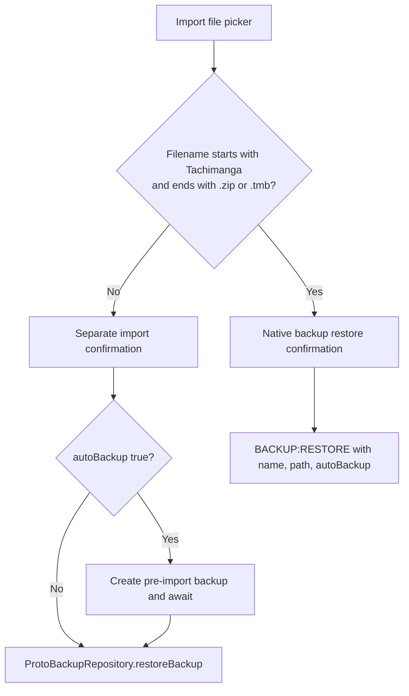

# Tachimanga 5.1 — جرد صفحات الإعدادات وتدفق النسخ

21 أكتوبر 2026. قراءة ثابتة للعينة المعدلة 5.1/520؛ لا تشغيل لكودها ولا ادعاء
تطابق بصري أو استعادة ناجحة. تكمل هذه المتابعة [عقد TMB الأصلي](TACHIMANGA-5.1-PLATFORM-AR.md)
و[سجل فجوات MSL](TACHIMANGA-5.1-SETTINGS-BACKUP-GAPS-AR.md).

## التغطية وحدود الجرد

فُحصت **33 طريقة، 9,330 تعليمة و37,320 بايت** مقابل App بواسطة Capstone،
مع **29 موضع تحقق** للنداءات والفروع وoperands المختارة.
يشمل ذلك build لخمس عشرة صفحة، وباني محتوى النسخ، وتهيئة تفضيلات النسخ
وفروع اختيار الملفات والتأكيد والطلب. فُحصت عناوين 13 فرعًا إلى مخرج async
المشترك `0x2f984` كفروع خارج الطريقة؛ لم تُنفذ.

الأداة: [review_tachimanga_settings.py](../scripts/review_tachimanga_settings.py).
الأدلة: [settings-backup-ui.json](../validation/rea/tachimanga-5.1-settings-backup-ui.json).
فهرس كائنات pool الأصلي وأسماء الفئات يساعدان على ربط عناصر التحكم؛ هذا
**جرد لمراجع كائنات ثابتة داخل الفروع**، وليس القائمة المرئية الكاملة أو ترتيبها
النهائي. بعض الصفوف تُنشأ ديناميكيًا ولا تظهر في هذا النوع من الجرد.

```bash
python3 scripts/review_tachimanga_settings.py /path/to/tachimanga-analysis-5.1 /tmp/settings.json
```

تحتاج إعادة الفحص `flutter-full/settings-followup/backup-settings-pool.json`
من أداة pool المراجعة؛ إزاحات الاستعلام في دليل JSON، ومنشأ الأداة في
[pool-followup.json](../validation/rea/tachimanga-5.1-pool-followup.json).
يبقى الملف الخام والأداة خارج مستودع الإنتاج.

## صفحات الإعدادات وعناصر مؤكدة في الفروع

الأسماء التالية أسماء فئات داخلية؛ عناوين المستخدم المترجمة قد تختلف.
وجود PremiumRequiredTile أو Fake* في العينة المعدلة لا يثبت استحقاق النسخة
الرسمية أو أن الخيار ظاهر دائمًا؛ لا تُنسخ هذه البوابات تلقائيًا إلى MSL.

| الصفحة ومدخل build | عناصر ثابتة ظهرت في الفروع المفحوصة |
|---|---|
| General، `0x5d5300` | CustomTabsTile، DefaultTabTile، StorageManagementTile |
| Appearance، `0x523980` | AppThemeTile، ThemeSelector، LiquidGlassSwitchTile، PureBlackDarkModeTile، BlendLevelSlider، AppIconSelectTile، CustomTabsTile، AppRotationTile، DateFormatSelectTile |
| Library، `0x5d829c` | EditCategoriesTile، DefaultCategoriesSelectTile، CategoryNumberDisplaySettingTile، LibraryDisplayModeSettingTile، LibraryBadgeSettingTile، UpdateSkipTitlesSettingTile، UpdateCategoriesSettingTile، UpdateContinuedTaskSettingEntryTile، MangaAutoRefreshSettingTile، UpdateMetadataSettingTile، RefreshLibraryCoversTile |
| Reader، `0x5641b0` | ReaderModeTile، ReaderPageLayoutTile، ReaderNavigationLayoutTile، ReaderBottomBarStyleTile، ReaderBackgroundColorTile، AutoWebtoonModeTile، ReaderPaddingSlider، ReaderSkipDuplicateChapters، WatermarkSwitchTile، ReaderApplePencilSettingTile، ReaderAdvancedTile |
| Downloads، `0x53a584` | DownloadsParallelSettingTile، DownloadContinuedTaskSettingEntryTile، DeleteDownloadAfterReadTile |
| Security، `0x570dcc` | LockSettingTile، LockIntervalTile، IncognitoModeTile، SecureScreenTile |
| Browse، `0x530d1c` | EditRepoTile، ShowNSFWTile؛ يوجد بناء ديناميكي لإعدادات المصدر |
| Advanced، `0x5cbaf4` | ClearCacheTile، ClearCookiesTile، ByPassTile، ByPassMuteRestTile، ReceiveTimeoutTile، PersistentTabsTile، RepairDatabaseTile، FileLogTile، HttpDumpTile |
| Backup، `0x529644` ومحتواه `0x52a480` | AutoBackupFrequencyTile، AutoBackupLimitTile، BackupToCloudTile؛ توجد فروع FakeBackupToCloudTile وبوابات منتج |

يشمل فحص build أيضًا SettingsScreen `0x5e2964` وReaderTapZonesSettingsScreen
`0x564c18` وReaderToolbarSettingsScreen `0x5db2c4` وReaderAdvancedScreen
`0x5db6b4` وStorageScreen `0x5e4748` وTrackerSettingsScreen `0x57b5e0`.
خلو قائمة constant controls لبعضها **لا يعني خلو الشاشة**؛ بناء الصفوف والقوائم
الديناميكي يحتاج تتبعًا منفصلًا قبل إغلاق SET-01.

هذا يثبت فجوة المظهر الحالية: شاشة MSL تعرض System/Light/Dark وعدد الأعمدة،
بينما المرجع يتضمن أيضًا اختيار السمة والأسود الصافي ومزج الألوان والأيقونة
والدوران والتاريخ وخيارات Liquid Glass ضمن الفروع. لا يثبت أن لونًا واحدًا
ثابتًا أو استعمال خط النظام يطابق كل سمة أو شاشة. قياسات الخلفيات والخطوط
العربية والإنجليزية والقوائم الفعلية ما زالت ضمن UI-06..08.

## ثلاثة تفضيلات مختلفة للنسخ

| المفتاح | الافتراضي المثبت | الخيارات المثبتة | دليل القراءة |
|---|---|---|---|
| `autoBackupFrequency` | `off` | off، update_6hour، update_12hour، update_24hour، update_48hour، update_weekly | build `0x3c239c`، enum initializer `0x3c2470`، مصفوفة `pp+0x25408` |
| `autoBackupLimit` | **2** | **2، 3، 4، 5** | build `0x397e30`، initialize `0x3974f8`، مصفوفة `pp+0x253b8` |
| `autoBackup` | **true** | خيار Boolean يقرأه تأكيد الاستعادة/الاستيراد | build `0x393df4` وConfirmRestoreContent `0x5d00a8` |

أسماء enum أعلاه محفوظة من الكائنات؛ لا يعني ظهور update_6hour أن جدولة
كل ست ساعات قِيست أثناء الخلفية أو أن iOS يضمن موعدًا دقيقًا.
autoBackup مستقل عن تكرار النسخ: تعطيل التكرار لا يثبت تعطيل النسخة التي
تسبق الاستعادة. القيم المحفوظة قد تحل محل الافتراضيات؛ شاشة حد الاحتفاظ
تستعمل 2 أيضًا إذا لم تحصل على قيمة.

تم ربط عناصر مصفوفة FrequencyEnum الستة بمراجع كائناتها في objs.txt،
وتطابق الافتراضي مع العنصر off. أداة pool نفسها مصدر بنية المصفوفات؛ لا
يُدّعى هنا فك مستقل كامل لبنية snapshot أو اختبار تنفيذ الاحتفاظ/الحذف.

## اختيار الملف: الاستعادة الأصلية أم استيراد protobuf؟



هذا وصف لقرار التوجيه في `importFilePicker` عند `0x52c5e4`:
يقرأ اسم الملف، ويفحص بادئة `Tachimanga` ثم لاحقة `.zip` أو `.tmb`.
إذا تطابقت، يستدعي showConfirmRestoreDialog عند `0x52c7e8`، وإلا يستدعي
showConfirmImportDialog عند `0x52c83c`. منتقي النسخ الآخر عند `0x52da60`
يتجه مباشرة إلى تأكيد الاستعادة.

showConfirmRestoreDialog عند `0x52b890` يقبل لاحقتي zip وtmb، ويعرض خطأ
عندما لا يطابق الاسم أيًّا منهما؛ لا يظهر هنا تحويل أو إعادة تسمية للمحتوى.
هذه فحوص اسم فقط؛ التحقق من meta.json وchecksum والإصدار وDB يقع في
المسار الأصلي الموثق في تقرير المنصة. لا يجوز الاعتماد على الاسم لإثبات الصيغة.

بعد التأكيد، closure عند `0x52be34` يقرأ خيار autoBackup، ثم يستدعي
BackupAction.restoreBackup عند `0x52bf5c`. الأخير، `0x52c2d4`، يبني طلب
BACKUP:RESTORE بمفاتيح name/path/autoBackup، ويحوّل Boolean إلى نص `"1"`
أو `"0"` في هذا الطلب. بعد await توجد متابعة لعرض حوار الاستعادة؛ نجاح
واجهة Flutter وحده لا يثبت سلامة كل خطوة DB أو الملفات عند فشل جزئي.

في الاستيراد الآخر، closure عند `0x52d1a0` يقرأ autoBackup. إذا كان true
يستدعي createBackup عند `0x52d298` وينتظر قبل استدعاء
ProtoBackupRepository.restoreBackup عند `0x52d33c`، ثم توجد فحوص استمرار
السياق قبل عرض حوار النتيجة. يتأكد بذلك فصل المسارين، وليس مجرد اختلاف امتداد.

## أثر ذلك على تنفيذ MSL

- BACKUP-03/04: فصل قارئ TMB عن protobuf/GZIP، ومعاينة المحتوى قبل الاستعادة،
  وعدم وصف تغيير اسم الملف أو استيراد JSON بأنه توافق Tachimanga.
- BACKUP-05/06: تأكيد الاستعادة وخيار النسخة السابقة وحالات الانتظار والنتيجة،
  مع التحقق من اتساق البيانات والتراجع واختبار جهاز جديد وفشل جزئي.
- BACKUP-07: جدولة النسخ والاحتفاظ والوجهة المحلية/السحابية، بعد تتبع تنفيذها
  واختبار قيود النظام؛ وجود هذه الخيارات لا يغلق اختبار الخلفية أو iCloud.
- SET-01..04: تحويل هذا الجرد إلى ربط لكل صف ديناميكي وخياراته وحفظه وأثره؛
  لا يُغلق جرد جميع الإعدادات بهذه المتابعة وحدها.

يبقى ترتيب التنفيذ المعتمد: إنهاء التحليل، ثم محرك الإضافات ومسار مصدر حقيقي
على iPhone، ثم استكمال بقية المطابقة. لم يتغير كود التطبيق في هذه المتابعة.
